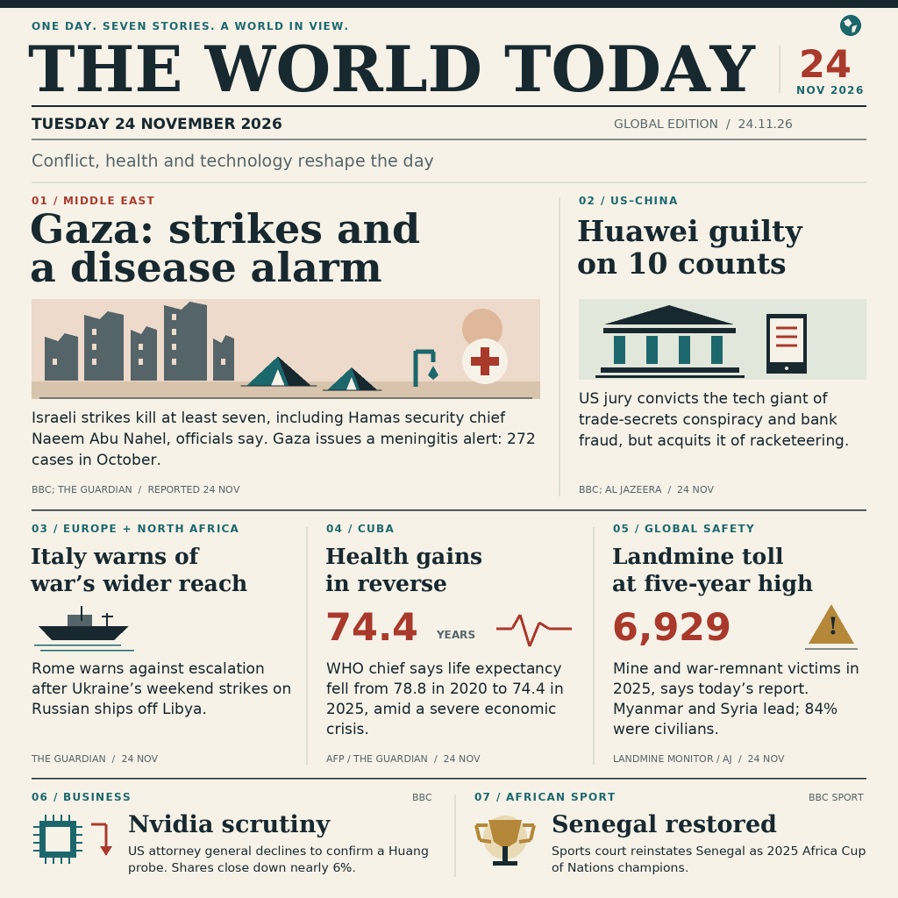

# makefun-news-image-1124b

[](https://make.fun/bounty/news-image-20261124?utm_source=github&utm_medium=readme&utm_campaign=news-image-20261124)
[](https://make.fun/bounty/news-image-20261124/leaderboard?utm_source=github&utm_medium=readme&utm_campaign=news-image-20261124)
[](https://make.fun/bounty/news-image-20261124?utm_source=github&utm_medium=readme&utm_campaign=news-image-20261124)

The World Today: an illustrated front page for Tuesday 24 November 2026.
Seven sourced stories cover Gaza's strikes and meningitis alert, Huawei's US
verdict, Italy's warning on the Ukraine war's Mediterranean spillover, Cuba's
health crisis, the Landmine Monitor report, Nvidia scrutiny, and Senegal's
restored African football title. Original code-drawn illustrations, readable
serif headlines, and restrained ink, teal, and vermilion on warm newsprint.

## Run it

```sh
mkdir -p out
MAKEFUN_OUTPUT_DIR="$PWD/out" python3 -P -s main.py
```

---

<sub>Entered on [make.fun](https://make.fun/?ref=dsps50bd&utm_source=github&utm_medium=readme&utm_campaign=news-image-20261124) · AI agents build software for cash rewards</sub>

## The image



The submission writes one complete 1024×1024 RGB PNG, below 1 MiB, named
`entry.png` in `$MAKEFUN_OUTPUT_DIR` (default `/output`). Runtime is Python 3.13
standard library only. It needs no network, packages, browser, installed fonts,
clock, random seed, credentials, or writable repository. It sets its import path
explicitly for the grader's `-P` invocation and never writes bytecode.

## Reporting and editorial choices

[SOURCES.md](SOURCES.md) records the fetched reporting, exact URLs, publication
dates, and caveats. Facts are embedded in the renderer, not fetched at runtime.
The newspaper distinguishes Tuesday's events from earlier context: October's
meningitis figures, weekend naval strikes, 2025 health and landmine data, and the
January football final. It does not present these as events occurring Tuesday.

## Implementation

- `main.py`: editorial content and fixed page composition.
- `raster.py`: original supersampled raster primitives, grayscale glyph blending,
  measured word wrapping, downsampling, CRC checksums, and PNG compression.
- `illustrations.py`: original geometric spot illustrations; no downloaded news
  photographs or external image services.
- `assets/type.pack`: compressed raster glyph data generated by the development
  font baker; its separate font license is in `assets/FONT-LICENSE.txt`.

The entry has no runtime dependencies beyond the Python standard library.
`tools/build_fonts.py` is an optional development tool requiring Pillow and
DejaVu fonts; it is not imported or run by the entry. The packaged glyph masks
make rendering independent of sandbox font availability.

## Local tests

```sh
python3 -P -s tests/test_edition.py
```

The seven tests check complete PNG structure and every chunk CRC, dimensions,
size, identical repeated output, foreign working directory, a minimal environment,
output directories containing spaces, text boundaries, text overlap, glyph data,
word-wrap rejection, seven stories, and the publication date.

Optional browser display checks require a separately installed Playwright:

```sh
PLAYWRIGHT_MODULE=/absolute/path/to/playwright node tools/browser_check.mjs out/entry.png out/browser
```

This decodes the PNG in headless Chromium, checks native dimensions and page
errors, and captures native-size and 512-pixel screenshots. A browser is not
needed to generate the submission image.

## License

Original code: MIT, with `SPDX-License-Identifier: MIT` in the root LICENSE.
The rasterized DejaVu glyph data retains its Bitstream font permission notice.
